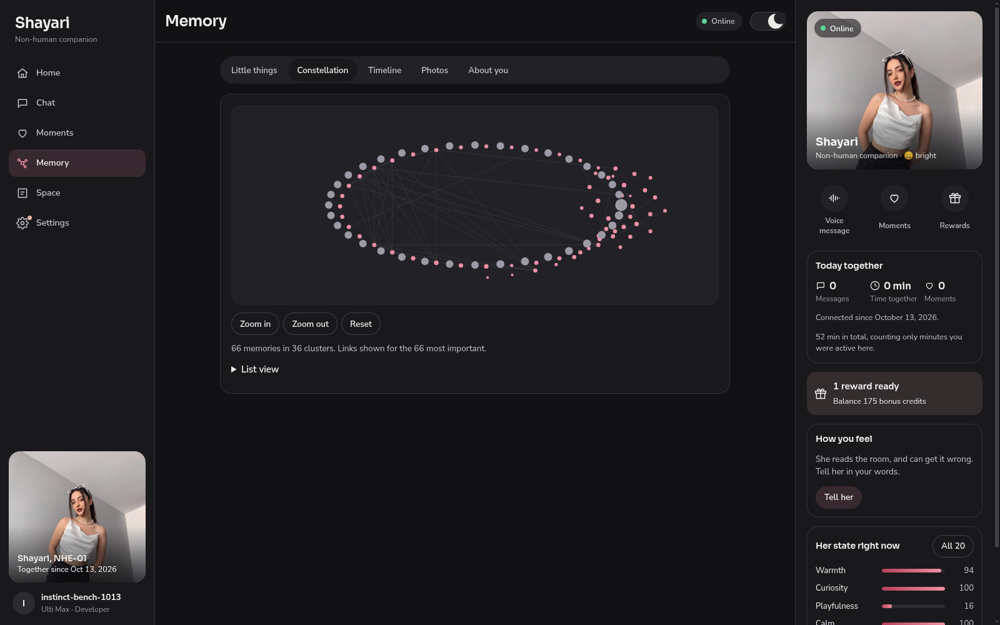
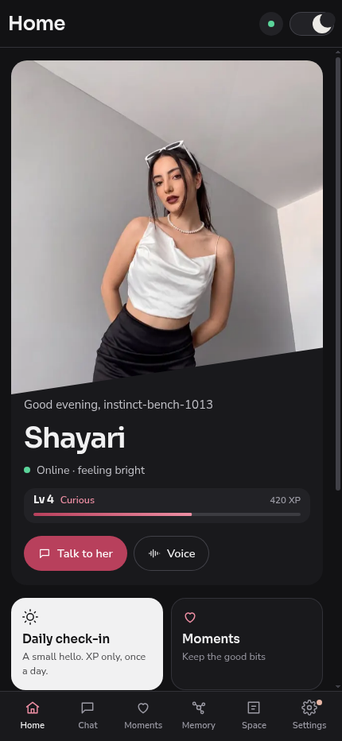
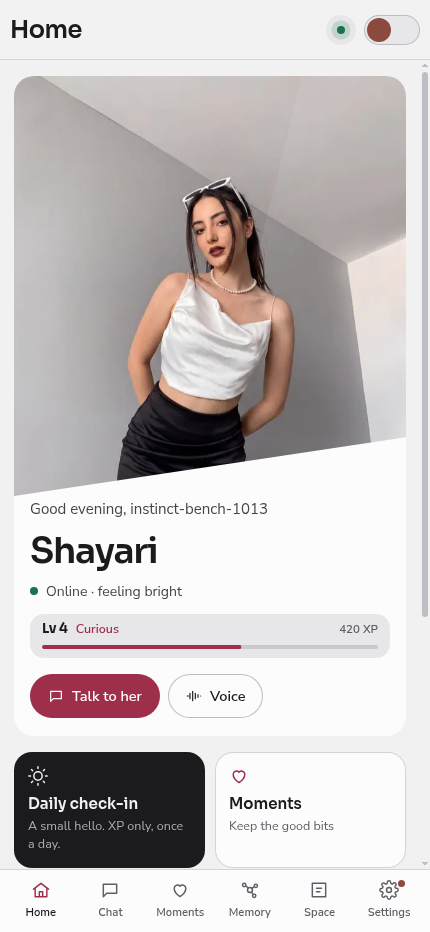
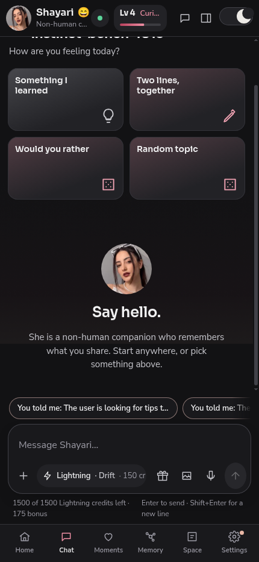
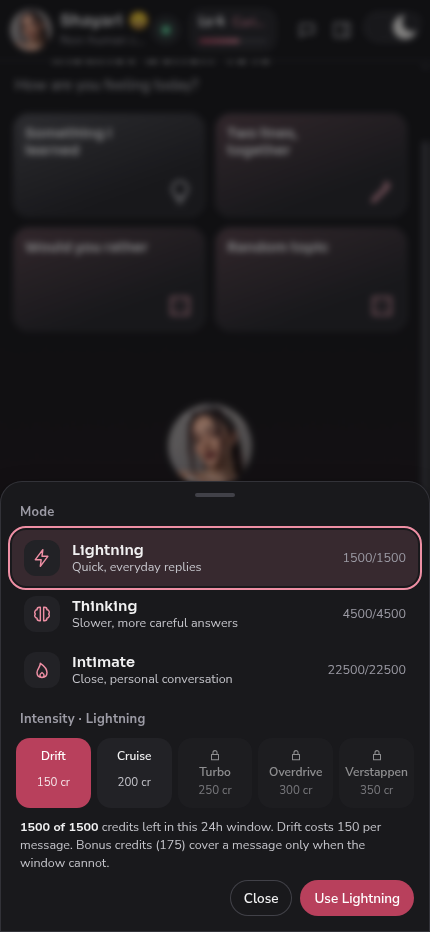
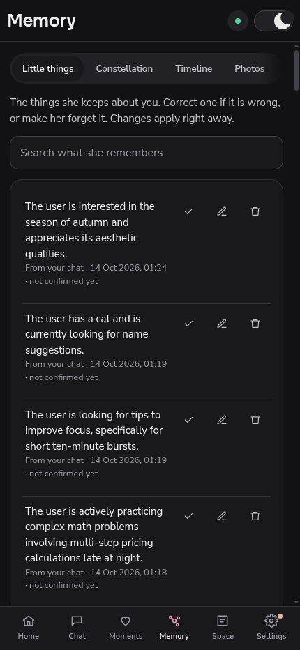
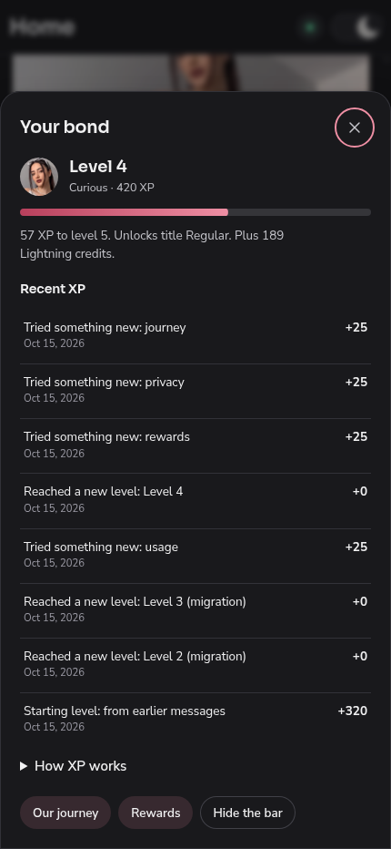

<picture>
  <source media="(prefers-color-scheme: dark)" srcset="assets/banner-dark.svg"/>
  
</picture>

 

## The programme

**Project NHE** is a research programme on **Non-Human Entities**: software that can hold a long-term relationship with a person, and says honestly what it is while doing it. No pretending to be human. No hidden mechanics. Every entity ships disclosed, inspectable and correctable.

It is built and run by [Pratham Prateek Mohanty](https://github.com/itsppm76) under **Writistic Studios LLP**. This repository is the public front of the programme: products, downloads and coverage. Implementation stays private.

## Entity 01 — Shayari NHE-01

**SHAYARI NHE-01** · *Synthetic Human-aligned Agent for Yielding Authentic and Relational Interactions*

An AI companion with memory, personality and continuity.

<a href="https://www.producthunt.com/products/shayari-nhe-01?embed=true&utm_source=badge-featured&utm_medium=badge&utm_campaign=badge-shayari-nhe-01" target="_blank" rel="noopener noreferrer"><picture><source media="(prefers-color-scheme: dark)" srcset="https://api.producthunt.com/widgets/embed-image/v1/featured.svg?post_id=1281410&theme=dark&t=1792130839357"></picture></a>

Shayari is the programme's first entity, live today. She remembers what you tell her across days and apps, runs three conversation modes on one unbroken thread, and shows her emotional state to you in a dashboard instead of hiding it. A safety check runs before anything else on every message.

She is a **fully disclosed Non-Human Entity**: the product says up front, always, that she is not a person.

### Get the app

| Platform | Download | Notes |
|---|---|---|
| **Web** | [Open Shayari](https://nhe01.projectnhe.tech/main) | Full experience in any browser |
| **Android v1.0.1** | [APK from Google Drive](https://drive.google.com/file/d/1ZYG64zHdxdPCjCl_sHNO6cPIwac52br5/view?usp=drive_link) | Not on the Play Store; the phone asks to allow the install |
| **Windows** | [Installer .exe](https://github.com/itsppm76/project-nhe-showcase/releases/download/desktop-v1.0.1/Shayari-Setup-1.0.1-windows-x64.exe) · [Portable .zip](https://github.com/itsppm76/project-nhe-showcase/releases/download/desktop-v1.0.1/Shayari-1.0.1-windows-x64-portable.zip) | Unsigned; on SmartScreen choose More info, then Run anyway |
| **macOS** | [Apple silicon .zip](https://github.com/itsppm76/project-nhe-showcase/releases/download/desktop-v1.0.1/Shayari-1.0.1-macos-apple-silicon.zip) · [Intel .zip](https://github.com/itsppm76/project-nhe-showcase/releases/download/desktop-v1.0.1/Shayari-1.0.1-macos-intel.zip) | Unsigned; first open is right-click, then Open |
| **Linux** | [.AppImage](https://github.com/itsppm76/project-nhe-showcase/releases/download/desktop-v1.0.1/Shayari-1.0.1-linux-x86_64.AppImage) · [.deb](https://github.com/itsppm76/project-nhe-showcase/releases/download/desktop-v1.0.1/Shayari-1.0.1-linux-amd64.deb) | Package verified; not device-tested |

Every app uses the same account and the same shared memory.

### On screen

  
<table>
<tr>
<td></td>
<td></td>
<td></td>
</tr>
<tr>
<td></td>
<td></td>
<td></td>
</tr>
</table>

### What makes her different

| | |
|---|---|
| **Three modes, one thread** | Lightning for fast replies, Thinking for deeper ones, Intimate for the full experience. Switching modes never forks the conversation. |
| **Memory you can inspect** | She saves what you tell her and uses it later. You can view, correct and delete every item. |
| **An emotional state you can see** | Her internal state shifts as a conversation goes and shapes her tone. It is shown to you, not hidden. |
| **Safety before personality** | A crisis check runs first on every message. An age gate protects younger users. |
| **Private by design** | Stored data is encrypted at rest. Service keys never reach your browser. |

## Around the programme

| | |
|---|---|
| **Programme site** | [projectnhe.tech](https://projectnhe.tech) |
| **Shayari's site** | [shayari.projectnhe.tech](https://shayari.projectnhe.tech) |
| **Open the app** | [nhe01.projectnhe.tech/main](https://nhe01.projectnhe.tech/main) |
| **Documentation** | [Companion Model docs](https://itsppm76.github.io/shayari-nhe01-docs/) |
| **Product Hunt** | [Shayari NHE-01](https://www.producthunt.com/products/shayari-nhe-01) |
| **Socials** | [X @nhe_01](https://x.com/nhe_01) · [Instagram @shayarinhe01](https://instagram.com/shayarinhe01) · [Telegram @shaynhe01bot](https://t.me/shaynhe01bot) |

 

 
Project NHE · Writistic Studios LLP · Proprietary, all rights reserved. This repository is a showcase. No application source, prompts, configuration or credentials are published here.

